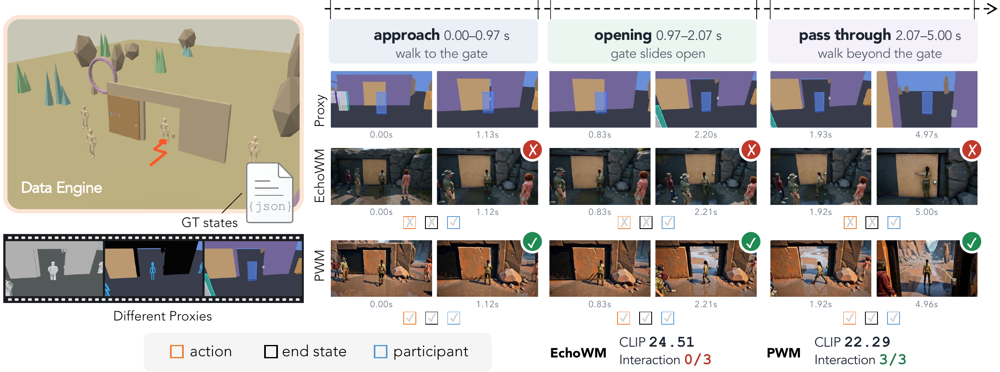

<div align="center">

<h1>PROWBench: Do Video Models Render What the Program Specifies?</h1>

<p><a href="https://alayalab.ai/">Alaya Lab</a></p>

[](https://alaya-lab.github.io/PROWBench/)
[](https://arxiv.org/abs/2610.02205)
[](https://alaya-lab.github.io/PROWBench/gallery.html)
[](https://huggingface.co/datasets/AlayaLab/PROWBench)

</div>

---

<p align="center">
  
</p>

<p align="center">PROWBench tests whether generated videos show the actions and end states prescribed by a program, using replayable world records as the reference.</p>

## 📢 News

- **2026/10/11** — Released the [dataset](https://huggingface.co/datasets/AlayaLab/PROWBench) with Viewer image previews and the [representation-swap tool](tools/representation-swap/) with runnable scripts and a verified before-and-after example.
- **2026/10/05** — The [paper](https://arxiv.org/abs/2610.02205) was updated on arXiv.

## 🚀 Quick start

Run these commands from the repository root:

```bash
# 1. Install (Python 3.11)
pip install -U huggingface_hub
pip install -r eval/requirements.txt

# 2. Download
hf download AlayaLab/PROWBench --repo-type dataset --local-dir PROWBench

# 3. Prepare
python3 tools/prepare_eval_data.py --download PROWBench --out prowbench-eval-data
```

`prowbench-eval-data/` uses symbolic links to the download; keep `PROWBench/` at its original location.

## 🎮 Evaluate your model

PROWBench's core data are engine recordings of scene states, object motion and camera trajectories, which serve as the
reference for evaluation. Use these records to create or adapt representations and write prompts suited to your model's
input requirements. We provide example representation videos (`white`, `mixed` and `colored-obb`) and prompts as starting points.

See the [representation-swap tool](tools/representation-swap/) for runnable code, a reusable skill and a before-and-after
demo of changing visible geometry while preserving the recorded camera and object trajectories.

**1. Generate videos.** Generate one video per view using your prepared inputs and, when needed, an available first-frame
reference. Evaluate one representation at a time and save outputs using this path (example below):

```text
model_output_video/<dataset>/<method>/<episode>/<camera>/<representation>/video.mp4
model_output_video/verified_ff_40/my_model/dv200-001-city-crossing/follow/mixed/video.mp4
```

Use the `episode` ID, `camera` and `representation` from `prowbench-eval-data/<dataset>/samples.jsonl`.
[Video requirements](eval/USAGE.md#2-generated-videos).

**2. Evaluate.** Set up [paths and environments](eval/USAGE.md), then follow your task guide:

| Dataset | Guide |
| --- | --- |
| `verified_ff_40`, `unverified_ff_90`, `gunfight` | [Five-second tasks](eval/USAGE.md#4-five-second-datasets-step-by-step) |
| `long_horizon` | [Long video (30 s)](eval/USAGE.md#5-long-horizon-dataset) |
| `multi4` | [Multi-view (5 s)](eval/USAGE.md#6-multi-view-dataset) |

**3. Collect results.** Final tables are written to `$WORK/table.json`; multi-view appearance and geometry scores
are in `$WORK/mv/summary.json`. [CPU example](eval/USAGE.md#9-worked-example-cpu) · [Resuming runs](eval/USAGE.md#7-re-running-and-resuming).

## 📏 Metrics

| Dimension | Metrics |
| --- | --- |
| Entity control | IoU, CErr, Miss |
| Camera control | Rot, Trans, CamMC |
| Logic and state | ISR, LRA, gISR, gLRA |
| Visual and temporal quality | Img, Aes, Smooth, Warp, CLIP |
| Multi-view consistency | Comp., Cons., MEt3R |
| Long-horizon memory | Re-IoU, Re-State |

Definitions, units and aggregation rules: [evaluation reference](eval/README.md).

## 📋 TODO

- [x] Paper and project page
- [x] Engine recordings, example representation videos and prompts
- [x] Evaluation code and usage guide
- [ ] Increase dataset diversity
- [ ] Release the World Generation Pipeline

## ⚖️ License

The code and [dataset](https://huggingface.co/datasets/AlayaLab/PROWBench) are released under the [MIT License](LICENSE).

## 📄 Citation

If you find PROWBench helpful for your research, please consider citing our paper:

```bibtex
@misc{huang2026prowbench,
  title={PROWBench: Do Video Models Render What the Program Specifies?},
  author={Zheng-Hui Huang and Guixu Lin and Yu-Ju Tsai and Jian-Kai Zhu and Fengbo Lan and Yu-Lun Liu and Yung-Yu Chuang and Kaipeng Zhang and Zhixiang Wang},
  year={2026},
  eprint={2610.02205},
  archivePrefix={arXiv},
  primaryClass={cs.CV},
  url={https://arxiv.org/abs/2610.02205}
}
```
