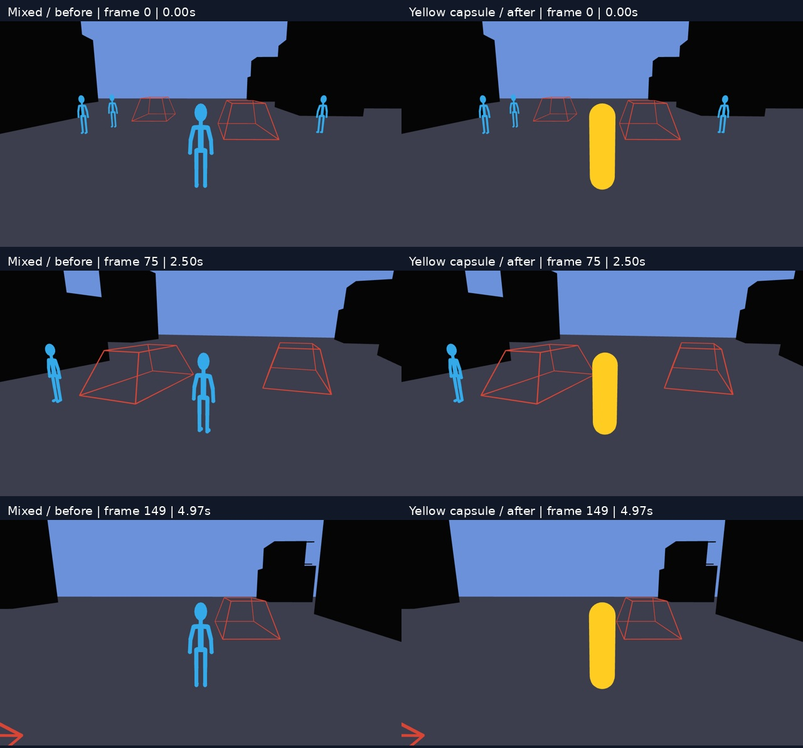

# Representation swap example

Replay the same PROWBench engine recording with a different visible representation.
This example replaces the `player` in the `mixed` representation with a yellow capsule,
preserving the recorded object motion, camera trajectory, frame times and other entities.

This directory contains the reusable skill, runnable scripts, instructions and example
results. You can copy the directory outside this repository. To render again, install
the dependencies below and point the scripts at a downloaded PROWBench episode.

## View the example

[Before-and-after video](results/city-crossing-capsule/checks/comparison.mp4)
· [Mixed video](results/city-crossing-capsule/render/mixed/video.mp4)
· [Capsule video](results/city-crossing-capsule/render/capsule-example/video.mp4)
· [Verification](results/city-crossing-capsule/checks/verification.json)



| Setting | Value |
| --- | --- |
| Episode | `episodes/verified_first_frame/city-crossing` |
| Camera / entity | `follow` / `player` |
| Output | Two 5-second videos, 150 frames each, 30 fps, 1280 × 720 |
| Replacement | Yellow capsule, `#ffcc22`, height 1.78 m, radius 0.26 m |
| Preserved transforms | Camera world and projection; all entity roots; replacement root |
| Verification | 150 frame pairs; 4,800 entity matrix checks; maximum transform error 0 |

Both videos are newly rendered from the same records. The checks also confirm that
the five source files remain unchanged and that the videos decode completely.
See the [result notes](results/city-crossing-capsule/README.md) for the exact environment,
timing, input hashes and scope of these claims.

## Contents

```text
representation-swap/
├── README.md
├── LICENSE                         # MIT license
├── skill/prowbench-swap-representation/
│   ├── SKILL.md                     # Reusable agent instructions
│   ├── agents/openai.yaml
│   ├── package.json / package-lock.json
│   ├── scripts/                     # Prepare, render and verify
│   ├── assets/                      # Replacement geometry and bundled replay runtime
│   └── references/                  # Replay contract and runtime provenance
├── results/city-crossing-capsule/
│   ├── README.md
│   ├── render/                      # Two videos, PNGs, transforms and renderer evidence
│   ├── checks/                      # Comparison video/image and independent checks
│   ├── logs/
│   └── input-provenance.json
└── SHA256SUMS                       # Checksums of the distributed files
```

## Reproduce

The commands below use Bash. Run them from **this directory**, wherever you copied it.
Use Node.js 22.12+ and Python 3 with `venv`. FFmpeg and ffprobe must be on `PATH`;
FFmpeg needs the `libx264` encoder and `drawtext` filter. Rendering requires WebGL2
and working GPU drivers; the included example was tested on Linux with NVIDIA H200.

### 1. Install dependencies

```bash
BUNDLE="$(pwd)"
SKILL="$BUNDLE/skill/prowbench-swap-representation"

python3 -m venv "$BUNDLE/.venv"
source "$BUNDLE/.venv/bin/activate"
python -m pip install Pillow huggingface_hub

(cd "$SKILL" && npm ci && npx playwright install chromium)
```

On Linux, if browser system libraries are missing, run
`(cd "$SKILL" && npx playwright install-deps chromium)`.
To reuse an existing browser installation for this Playwright version, set
`PLAYWRIGHT_BROWSERS_PATH` to its cache directory before rendering.

### 2. Select or download the input

For an existing download, set `DATA` to the directory containing `episodes/`:

```bash
DATA="/absolute/path/to/PROWBench"
EPISODE="$DATA/episodes/verified_first_frame/city-crossing"
```

Alternatively, download just this episode. The pinned revision matches the supplied
results; you can select a newer release to make a new comparison.

```bash
DATA="$BUNDLE/data"
hf download AlayaLab/PROWBench --repo-type dataset \
  --revision 9d731e1554949a1875d79ca86023bc26a796695b \
  --include 'episodes/verified_first_frame/city-crossing/*' \
  --local-dir "$DATA"
EPISODE="$DATA/episodes/verified_first_frame/city-crossing"
```

Use the raw episode containing `manifest.json`, `scene/` and `cameras/`.
Keep the data at its chosen location: prepared input uses symlinks to the original
GLB, frame states and selected camera. The dataset itself is not bundled here.

### 3. Prepare, render and verify

Choose a **new** working directory for each run; each stage requires an empty output
directory. Keep the distributed `results/` as the reference example.

```bash
WORK="$BUNDLE/work/capsule-v1"
python "$SKILL/scripts/prepare_episode.py" \
  --episode "$EPISODE" --camera follow --entity player \
  --out "$WORK/replay-input"

node "$SKILL/scripts/render_pair.mjs" \
  --input "$WORK/replay-input" --out "$WORK/render" \
  --entity player --color '#ffcc22' --height 1.78 --radius 0.26

python "$SKILL/scripts/verify_pair.py" \
  --input "$WORK/replay-input" --render "$WORK/render" \
  --out "$WORK/checks"
```

The main outputs are `checks/comparison.mp4`, `checks/comparison.jpg` and
`checks/verification.json`. The individual videos are under `render/mixed/` and
`render/capsule-example/`. The verifier compares recorded transforms, checks source
hashes, fully decodes both videos and checks that the visible results differ.

For a quick preview, use a separate output directory:

```bash
node "$SKILL/scripts/render_pair.mjs" \
  --input "$WORK/replay-input" --out "$WORK/preview" --frames 0,75,149
```

GPU rendering is the default. Check `render/render-backend.json` for the actual
WebGL device. A failed GPU check stops the run. To deliberately use software
rendering, pass `--render-backend cpu`. Use `--port 4392` if port 4391 is occupied.
H.264 encoding uses CPU `libx264` for both rendering backends.

## Adapt the representation or use the skill

Start from [SKILL.md](skill/prowbench-swap-representation/SKILL.md). To install it in
an agent's skill directory, copy the entire `skill/prowbench-swap-representation/`
directory, then install its npm dependencies there. The scripts also work directly
without an agent or skill installation.

For this capsule, change `--entity`, `--color`, `--height` or `--radius`. For another
shape or asset, edit [assets/replacement.js](skill/prowbench-swap-representation/assets/replacement.js).
Keep the object's root matrix driven by the recorded `state.worldMatrix`; apply
scale, orientation and pivot corrections inside the local geometry. Preserve the
camera matrices, timestamps, visibility and the configuration of other entities.
The [replay contract](skill/prowbench-swap-representation/references/replay-contract.md)
describes the input schema and checks in more detail.

Select visible targets: a first-person camera can hide `player`. The preparation
script restricts its derived camera index to the selected published track, because
the source index may also list tracks absent from the download.

This is an RGB control-input rendering example. It does not run a video generation
model or benchmark evaluation. A changed shape changes its silhouette and occlusions;
new depth, normal or instance-ID inputs require rendering the new geometry too.
Write a prompt describing the new visible input and the requested output for your
model. The engine records remain the trajectory and scene-state reference.

## License

This example is released under the [MIT License](LICENSE).
